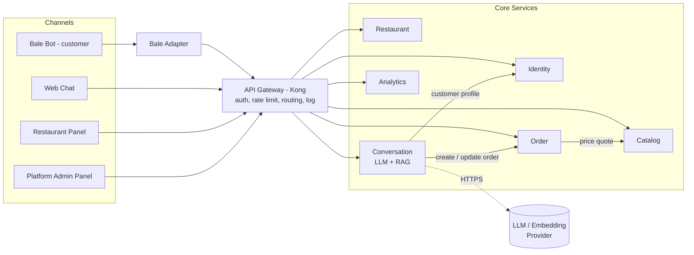
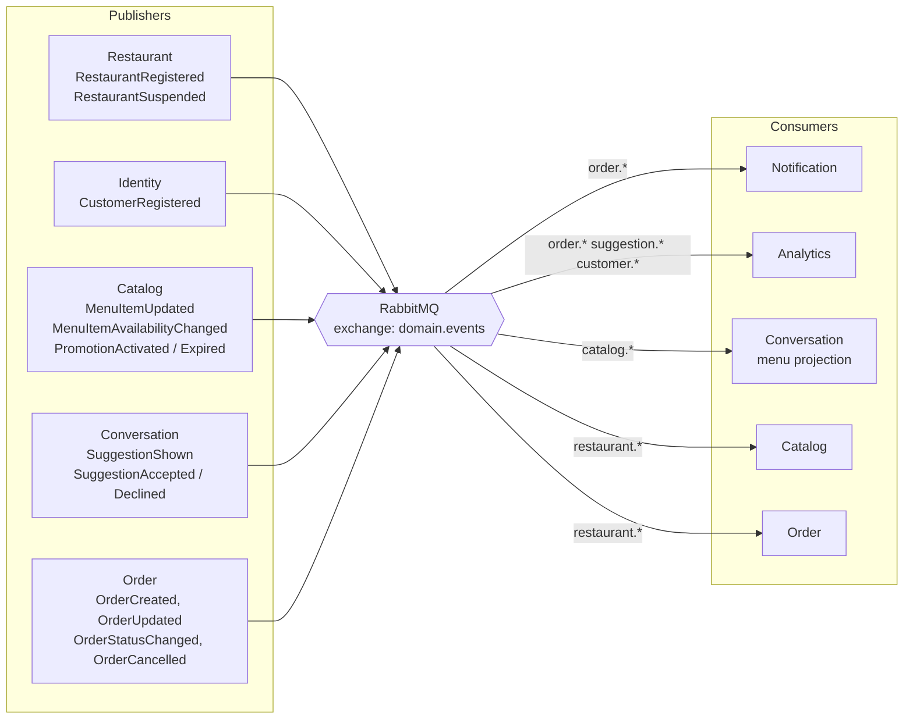
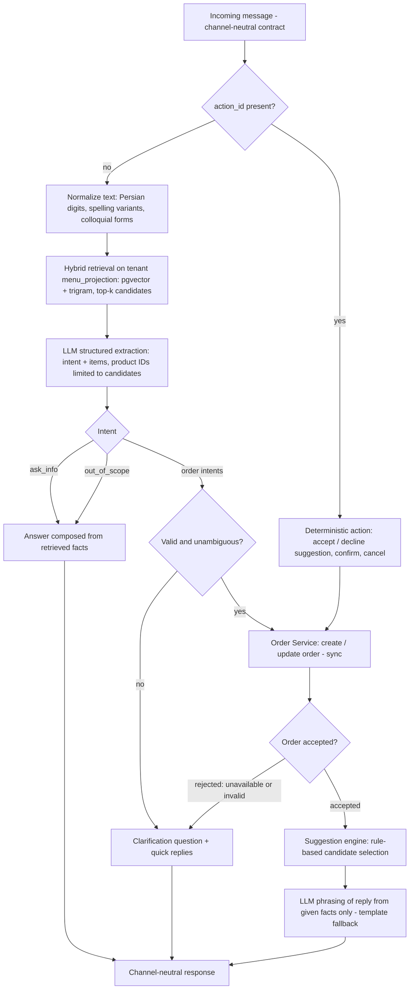
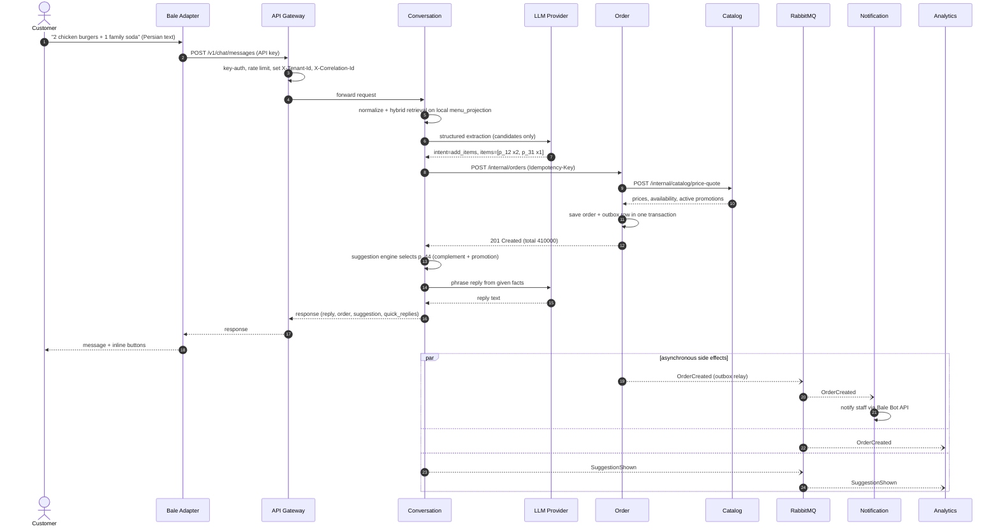
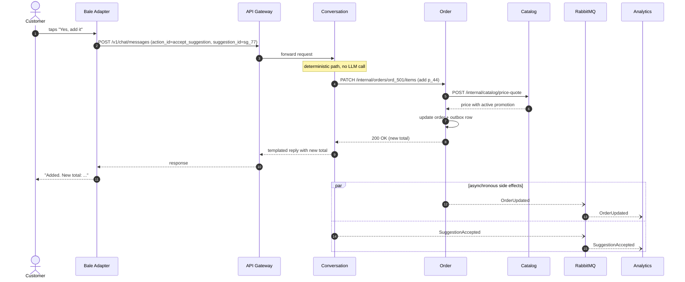
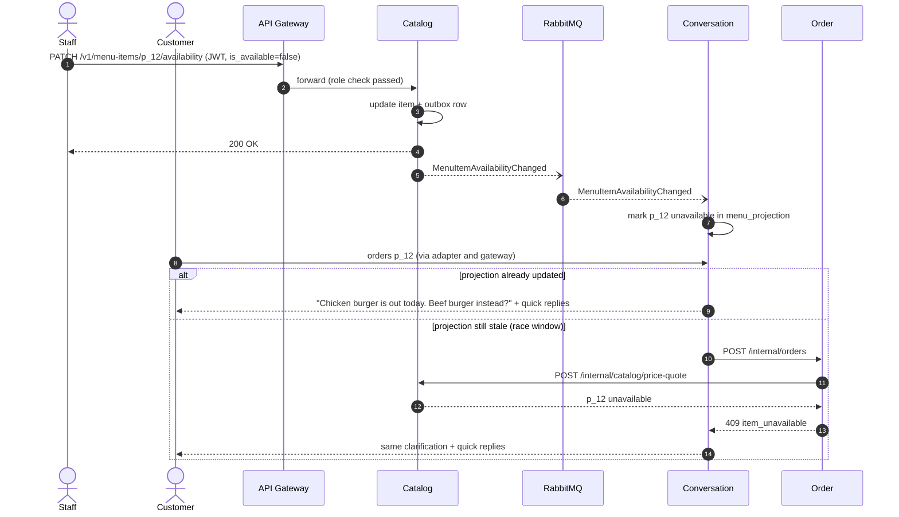
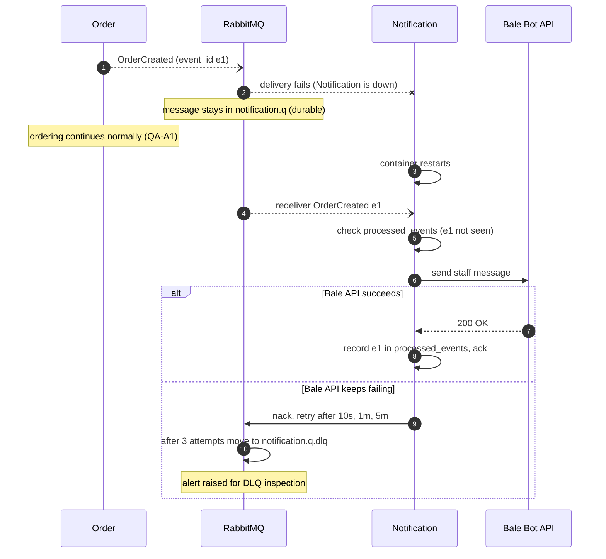
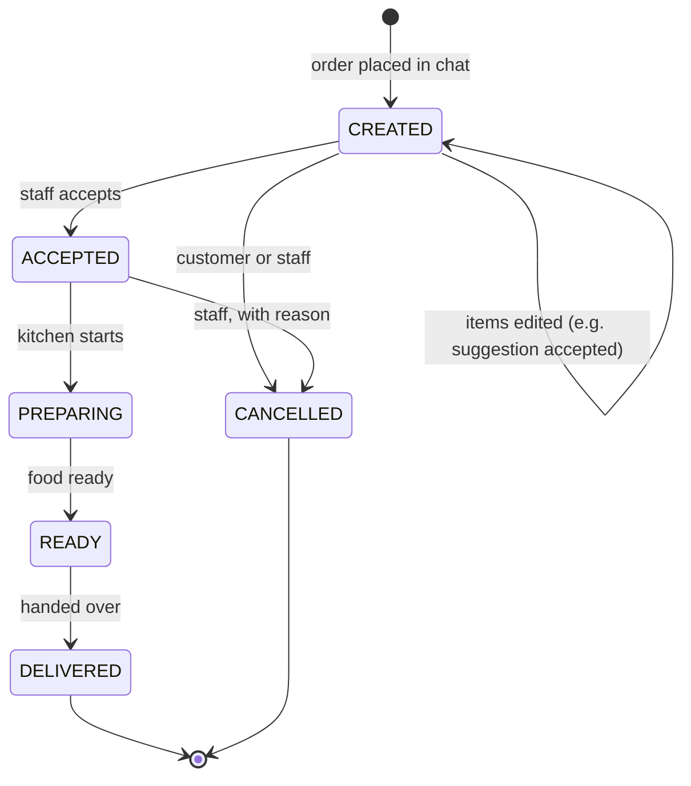
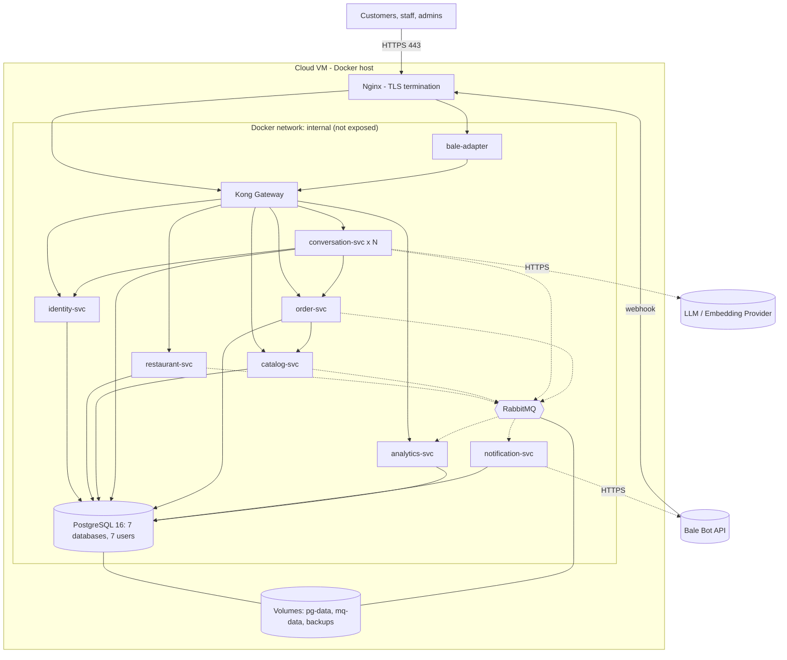

# Software Architecture Document (SAD)
## Smart Restaurant Ordering System

| Field | Value |
| --- | --- |
| Project | Smart Restaurant Ordering System (conversational, RAG-based) |
| Course | Software Engineering — Faculty of Computer Engineering, Yazd University |
| Instructor | Dr. Mohammad Ali Zare Chahooki |
| Author | Amirhossein Talavatifard |
| Version | 1.0 |
| Status | Draft for review |
| Baseline document | Project Business Specification, version 1.0 |

### Revision History

| # | Change | Date |
| --- | --- | --- |
| 1 | Initial architecture document | 2026-11-13 |
| 2 | Moved to `docs/architecture/SAD.md`; repository root renamed to `restaurant-smart-ordering/` in section 12.4; ADR-12 (uv and Python 3.12 pin) added to section 14 | 2026-11-13 |
| 3 | Section 12.4 updated to the src layout of the uv workspace members; ADR-13 (proposed) and ADR-14 (src layout) added to section 14 | 2026-11-13 |

### Table of Contents

1. [Introduction](#1-introduction)
2. [Architectural Drivers](#2-architectural-drivers)
3. [Architectural Style and Rationale](#3-architectural-style-and-rationale)
4. [Service Decomposition](#4-service-decomposition)
5. [Component View](#5-component-view)
6. [Inter-Service Communication](#6-inter-service-communication)
7. [Event Catalog](#7-event-catalog)
8. [Data View](#8-data-view)
9. [AI Core Design](#9-ai-core-design-conversation-service)
10. [Scenarios and Sequence Diagrams](#10-scenarios-and-sequence-diagrams)
11. [API Contract](#11-api-contract)
12. [Deployment View and Technology Stack](#12-deployment-view-and-technology-stack)
13. [Security and Observability](#13-security-and-observability)
14. [Architecture Decision Records (ADR)](#14-architecture-decision-records-adr)
15. [Architecture Evaluation: ATAM and SAAM](#15-architecture-evaluation-atam-and-saam)
16. [Risks and Architectural Debt](#16-risks-and-architectural-debt)
17. [Agile Delivery Plan and Test Strategy](#17-agile-delivery-plan-and-test-strategy)
18. [Traceability Matrix](#18-traceability-matrix)
19. [References](#19-references)

> **Language note for implementers:** the system's end users write and read Persian. All customer-facing text (chat replies, quick-reply labels, notifications) is Persian. Code, identifiers, logs, API fields and documentation are English. Persian strings in the examples below are intentional sample data.

---

## 1. Introduction

The Smart Restaurant Ordering System is a multi-tenant cloud service (SaaS) that understands a customer's order from a natural conversation, places it, and offers sales suggestions grounded in the real data of that same restaurant. This document defines the system as **a set of independent microservices with hybrid synchronous and event-driven communication**.

### 1.1. Purpose

This document answers the core architecture questions: what parts the system consists of, how they communicate, how data flows, how the system is deployed and evolved, and which quality attributes it guarantees. It also records the rationale and trade-offs behind each significant decision so they remain traceable throughout the project.

### 1.2. Scope

| In scope for v1 | Out of scope for v1 (planned for later versions) |
| --- | --- |
| Conversational ordering in colloquial Persian | Online payment for customer orders (v1 is pay on delivery / in place) |
| Discount and complementary-item suggestions during ordering | Customer loyalty program |
| Management of menu, availability, promotions and complements | Machine-learning-based suggestions (v1 is rule-based) |
| Order queue and status changes by staff | Dedicated mobile app |
| Notifications via the Bale bot | Other channels (Telegram, WhatsApp) |
| Report on the sales impact of suggestions | Multilingual support |
| Multi-tenancy, subscriptions and restaurant management | Support ticketing system |

### 1.3. Audience

| Audience | Relevant sections |
| --- | --- |
| Instructor and reviewers | 2, 3, 4, 6, 14, 15 |
| Developers | 5 to 13 |
| DevOps | 12, 13 |
| Project manager | 16, 17 |

### 1.4. Mapping to Kruchten's 4+1 Views

| View | Question it answers | Section |
| --- | --- | --- |
| Logical | Which services and responsibilities make up the system? | 4, 5, 9 |
| Process | How do components interact at runtime? | 6, 7, 10 |
| Development | How is the code organized and delivered? | 12.4, 17 |
| Physical | On what infrastructure do components run? | 12 |
| Scenarios (+1) | How does the architecture behave in real situations? | 10, 15 |

### 1.5. Glossary

| Term | Definition in this document |
| --- | --- |
| Microservice | A small, independent program that implements one business capability, owns its database, and is deployed separately. |
| Business Capability | Something the business does, e.g. "place an order" or "manage the menu"; the criterion for service boundaries. |
| Tenant | A restaurant on the platform; each tenant's data is isolated from the others. |
| API Gateway | Single entry point for all external requests; authentication, rate limiting, routing, logging. |
| Event | An announcement that something happened in the past, e.g. `OrderCreated`; not a command. |
| Message Broker | Infrastructure that receives, stores and delivers events to consumers (RabbitMQ). |
| Eventual Consistency | Data is not identical across services instantly, but converges shortly after. |
| RAG | Retrieval-Augmented Generation: before answering, the LLM retrieves relevant facts from the restaurant's knowledge base and answers only from them. |
| Channel Adapter | Edge component that converts a channel's messages (e.g. the Bale bot) into the system's single contract and renders responses in that channel's format. |
| Transactional Outbox | A pattern that saves business data and the outgoing event in one database transaction so no event is ever lost. |
| Dead Letter Queue (DLQ) | Queue that receives messages which failed processing after several attempts, for inspection. |

---

## 2. Architectural Drivers

Three groups of factors shape the architecture: key functional requirements, measurable quality attributes, and project constraints. The primary goal of the architecture is to satisfy the quality attributes; merely "working" is not enough.

### 2.1. Key Functional Requirements

| ID | Requirement | Actor (from the business specification) |
| --- | --- | --- |
| FR-01 | Place an order from free-form Persian text in chat | Guest and member customer |
| FR-02 | Ask a clarifying question when the order is ambiguous or an item is unavailable | Customer |
| FR-03 | Offer a discount or complementary item after the order is placed, and add it on customer confirmation | Customer, restaurant manager |
| FR-04 | Answer questions about ingredients and prices | Customer |
| FR-05 | Edit, cancel and track an order | Member customer |
| FR-06 | Manage menu, prices, availability, promotions and complements | Restaurant manager and staff |
| FR-07 | Show the order queue and change order status | Restaurant staff |
| FR-08 | Notify staff of new orders and customers of status changes | System |
| FR-09 | Report suggestion acceptance rate and sales impact | Restaurant manager |
| FR-10 | Register, approve and suspend restaurants; manage subscriptions | Platform technical admin, platform finance admin |

### 2.2. Quality Attribute Scenarios

Each quality attribute is written as a testable scenario. Numbers are **v1 targets** and are measured by the tests in section 17.

| ID | Attribute | Stimulus | Expected response | Acceptance measure |
| --- | --- | --- | --- | --- |
| QA-P1 | Performance | Customer sends an order message | Full reply with the placed order | p95 response time ≤ 6 s (including the LLM call) |
| QA-P2 | Performance | Staff opens the order queue | Order list | p95 ≤ 300 ms |
| QA-S1 | Scalability | More restaurants and concurrent conversations | Add instances of the hot service without code changes | 100 restaurants and 200 concurrent conversations in v1 |
| QA-A1 | Availability | Notification or Analytics service goes down | Ordering continues uninterrupted | Failure of side services has zero effect on the ordering path |
| QA-A2 | Availability | Normal operation | Ordering path available | 99.5% per month |
| QA-R1 | Reliability | A service or the broker restarts after an order is placed | No confirmed order or event is lost | Zero lost events in failure tests |
| QA-SEC1 | Security | Request with one restaurant's key for another restaurant's data | Request rejected | Zero cross-tenant leakage in security tests |
| QA-SEC2 | Security (price integrity) | LLM or client produces a wrong price | Price is read only from Catalog | Zero orders priced differently from the menu |
| QA-M1 | Modifiability | Add a new channel (e.g. Telegram) | Only a new adapter is written | No change in any core service |
| QA-M2 | Modifiability | Replace the LLM provider | Change only in the Conversation adapter layer | No change in other services |
| QA-AI1 | AI accuracy | Messages in the golden test set | Correct items and quantities extracted | Exact-match accuracy ≥ 90% on 200 labeled conversations |
| QA-AI2 | Grounding | Customer asks for an item not on the menu | System never places or suggests a made-up item | Zero off-menu items in orders |

### 2.3. Constraints

| ID | Constraint | Architectural impact |
| --- | --- | --- |
| C-01 | Time: first release within 8 weeks (XP short-release principle) | Simpler tools (RabbitMQ instead of Kafka, Docker Compose instead of Kubernetes) |
| C-02 | Small team skilled in Python and FastAPI | Same language for all services to reduce maintenance cost |
| C-03 | Iran's network: the Bale bot is reachable without a VPN | Bale is the first channel; channels are decoupled from the core |
| C-04 | The LLM is called through an external API | Provider abstraction, timeouts and a fallback path are mandatory |
| C-05 | Low infrastructure budget | v1 deployed on a single cloud VM |
| C-06 | Input is colloquial Persian with typos and Persian digits | Text normalization and hybrid vector + lexical search |

### 2.4. Assumptions

- Each restaurant's menu has fewer than 300 items.
- In v1, orders are paid in place or on delivery.
- The customer's channel identity (e.g. Bale user ID) is stable and sufficient to identify a member customer.
- Each order belongs to exactly one restaurant.

---

## 3. Architectural Style and Rationale

The chosen style is **microservices with hybrid communication**: the critical ordering path is synchronous (REST) and side effects are event-driven through RabbitMQ.

### 3.1. Options Compared

| Criterion | Monolith | Classic SOA (with ESB) | Microservices + event-driven |
| --- | --- | --- | --- |
| Independent deployment | No; every change redeploys the whole system | Limited | Yes |
| Failure isolation | One failing part stops the whole system | The central bus (ESB) is a single point of failure | A failing side service does not stop ordering |
| Scalability | Whole system only | Medium | Per service (e.g. only Conversation) |
| Adding a capability or channel | Requires changes to shared code | Requires changes to the ESB | A new service or adapter that listens to events |
| Operational complexity | Low | High (heavy SOAP/XML tooling) | Medium to high |
| Data consistency | Immediate | Immediate | Eventual on non-critical paths |

### 3.2. Rationale

1. **QA-A1 and QA-R1:** ordering must not depend on notifications or reporting. In an event-driven design, Order only publishes `OrderCreated`; consumer failures do not affect it.
2. **QA-S1:** the main load is in the AI part (LLM calls). Isolating Conversation allows scaling only that service.
3. **QA-M1 and QA-M2:** channels and the LLM provider sit behind a stable contract; changing them does not ripple through the system.
4. **SaaS business model:** restaurants buy subscriptions; independent cloud services are the foundation of that model.

### 3.3. Position in the SOA-to-SaaS Pyramid

| Layer | Realization in this project |
| --- | --- |
| SOA (the idea) | The starting question "what services does a restaurant business consist of?" and splitting the system into services |
| API (the access path) | A versioned, channel-independent REST contract behind the API Gateway |
| Microservices (the build method) | Seven independent services with separate databases and deployments |
| Cloud (where it runs) | Containers on cloud infrastructure |
| SaaS (the business model) | Multi-tenancy; every restaurant uses the same service via subscription |

### 3.4. Cost of This Choice

Microservices are not free. These costs are accepted deliberately, each with a mitigation:

| Cost | Mitigation |
| --- | --- |
| Harder debugging | Correlation ID on every request and event, structured logs (section 13) |
| More complex consistency | Eventual consistency only on non-critical paths; the ordering path is synchronous and transactional |
| Operational complexity | Docker Compose, uniform service configuration, a shared service template |
| Risk of a "distributed monolith" | Synchronous chains of at most three services; everything else event-driven (section 6) |

---

## 4. Service Decomposition

Services are bounded by **business capability**, not by database tables. The result is seven core services and two edge components.

### 4.1. Step 1: Capability Extraction

Capabilities were extracted from the goals and features of the business specification:

| Capability | Origin in the business specification |
| --- | --- |
| Authentication and access control | Staff and access management, admin account management |
| Tenant and subscription management | Restaurant management, subscription plans, invoicing |
| Menu and sales-rule management | Menu, promotions, complements, availability |
| Conversation and smart suggestions | Ordering via chat, smart suggestions, answering questions |
| Order management | Placing, editing, cancelling and tracking orders |
| Notification | New-order alerts, delay and status notifications |
| Analytics and reporting | Suggestion performance, sales and revenue reports |

### 4.2. Step 2: Service Boundaries

| Service | Responsibility | Owned data | Published events | Consumed events |
| --- | --- | --- | --- | --- |
| **Identity** | Login, JWT issuance, roles, member-customer profile | Users, roles, customers, channel identities | `CustomerRegistered` | — |
| **Restaurant** | Tenants, subscriptions, per-restaurant API keys | Restaurants, plans, subscriptions, keys | `RestaurantRegistered`, `RestaurantSuspended` | — |
| **Catalog** | Menu, prices, availability, promotions, complements | Items, categories, promotions, complement rules | `MenuItemUpdated`, `MenuItemAvailabilityChanged`, `PromotionActivated`, `PromotionExpired` | `RestaurantRegistered`, `RestaurantSuspended` |
| **Conversation** | Dialogue, order extraction, RAG, suggestions | Sessions, messages, menu read model and embeddings | `SuggestionShown`, `SuggestionAccepted`, `SuggestionDeclined` | Menu and promotion events |
| **Order** | Placing, validating, editing orders; order status | Orders, order items, status history | `OrderCreated`, `OrderUpdated`, `OrderStatusChanged`, `OrderCancelled` | `RestaurantSuspended` |
| **Notification** | Sending messages to customers and staff over channels | Message templates, delivery log | — | Order events |
| **Analytics** | Sales and suggestion-impact reports | Aggregated report tables | — | Order, suggestion and customer events |

**Edge components (no business logic):**

| Component | Role |
| --- | --- |
| API Gateway (Kong) | Single entry, authentication, rate limiting, routing, logging |
| Bale adapter | Receives messages from the Bale Bot API, converts them to the single contract, renders replies and buttons |
| Web chat adapter | Demo chat page for a restaurant website (iteration 4) |

### 4.3. Anti-Patterns Avoided

| Anti-pattern | What we deliberately did not do | Why |
| --- | --- | --- |
| One service per entity | No separate services for promotions, complements, customers or messages | They are data of one capability; splitting them creates chatty communication and tight coupling |
| Shared database | No service reads another service's tables | A schema change in one service must not break another |
| Long synchronous chains | Order does not call Notification or Analytics for alerts and stats | A failure anywhere in the chain would break the whole chain |
| Business logic in the gateway | The gateway does not check prices, availability or order permissions | The gateway only controls entry; business decisions belong to the service |
| Calling Catalog on every chat message | Conversation keeps its own read model of the menu, updated by events | Lower latency and runtime coupling (section 8.3) |

---

## 5. Component View

All external requests enter through the API Gateway. The critical ordering path (Conversation → Order → Catalog) is synchronous; everything else goes through RabbitMQ as events. For readability the two aspects are drawn as two diagrams. Each service's database is described in section 8.

### 5.1. Synchronous Paths



Notification does not appear here because it receives no synchronous requests; it works only through events.

### 5.2. Event Flow



No publisher knows its consumers. For example, adding a new service that listens to `order.*` requires no change to Order.

---

## 6. Inter-Service Communication

One rule governs all communication: **critical, immediate operations are synchronous; side effects and independent operations are event-driven.** REST says "do this"; an event says "this happened".

### 6.1. Interaction List

| From | To | Type | Protocol | Why this type |
| --- | --- | --- | --- | --- |
| Channels and panels | API Gateway | Sync | HTTPS / REST | The user is waiting for a reply |
| Conversation | Order | Sync | Internal REST | The customer must see the order confirmation immediately |
| Order | Catalog | Sync | Internal REST | Price and availability integrity is critical (QA-SEC2) |
| Conversation | Identity | Sync (once per session) | Internal REST | Member-customer profile is needed to complete the order |
| Conversation | LLM provider | Sync | HTTPS | Reply generation is part of the critical path |
| Order | Notification, Analytics | Async | Event | Side effect; must not slow down or block ordering |
| Catalog | Conversation | Async | Event | Updates the menu read model; a few seconds of delay is acceptable |
| Conversation | Analytics | Async | Event | Suggestion statistics are a side effect |
| Restaurant | Catalog, Order | Async | Event | Tenant setup or suspension; no immediate reply needed |

A synchronous chain never exceeds three services (Conversation → Order → Catalog). This cap prevents the system from turning into a "distributed monolith".

### 6.2. API Gateway vs. Service Responsibilities

**The API Gateway only controls entry; the service makes the business decision.**

| Check | API Gateway | Target service |
| --- | --- | --- |
| JWT validity (signature, expiry) | ✓ | |
| Restaurant API key validity (adapters) | ✓ | |
| Rate limiting per tenant and per user | ✓ | |
| Basic role authorization (e.g. only staff on `/v1/orders/{id}/status`) | ✓ | |
| Routing to the right service and adding `X-Correlation-Id` | ✓ | |
| Access logging | ✓ | |
| Item existence, availability and price validity | | ✓ Order (with Catalog) |
| Promotion validity and time window | | ✓ Catalog |
| Whether the order may be edited in its current status | | ✓ Order |
| Whether the restaurant's subscription is active | | ✓ Order (from Restaurant events) |
| Data belongs to the same tenant | | ✓ every service |

### 6.3. Reliability Mechanisms

| Mechanism | Where applied | Problem solved |
| --- | --- | --- |
| **Transactional Outbox** | All publishing services: Identity, Restaurant, Catalog, Conversation, Order | Data and event are saved in one transaction; events survive broker failure (QA-R1) |
| **At-least-once delivery** | RabbitMQ with durable queues, persistent messages, publisher confirms | Messages are kept until the consumer acknowledges |
| **Idempotent consumers** | All consumers, via a `processed_events` table | Duplicate messages have no duplicate effect (e.g. two notifications) |
| **Retry with increasing delay** | Delay queues: 10 s, 1 min, 5 min | Transient errors resolve themselves |
| **Dead Letter Queue (DLQ)** | One DLQ per queue | A faulty message is set aside for inspection after 3 attempts |
| **Idempotency key** | `POST /internal/orders` with the chat message ID | A Conversation retry never creates a duplicate order |
| **Timeouts** | Order → Catalog: 2 s · Conversation → Order: 3 s · LLM: 8 s | One slow service does not stall the whole chain |
| **Circuit breaker** | Conversation → LLM | After 5 consecutive failures, a 30 s fallback mode (button-based menu) is enabled |

### 6.4. Eventual Consistency in This System

| Situation | Acceptable delay | Why it is not a problem |
| --- | --- | --- |
| New-order notification to staff | A few seconds | The order is already placed and visible in the staff panel queue |
| Report updates | Up to one minute | Reports do not drive real-time decisions |
| A menu change reaching Conversation | Under 5 seconds | If the read model is still stale, Order validates against Catalog at placement time and rejects unavailable items; Conversation then asks the customer |

The third row is the key decision of this section: **eventual consistency only affects display data, never orders.** Final price and availability are always read synchronously from the source of truth (Catalog).

---

## 7. Event Catalog

Event names are in the past tense (`OrderCreated`, not `CreateOrder`) because an event announces something that happened; it is not a command. A publisher does not know who receives its events.

### 7.1. Event Envelope

All events share the same envelope:

```json
{
  "event_id": "8f14e45f-ceea-467a-9a4b-2c1d8e0b7a21",
  "event_type": "OrderCreated",
  "event_version": 1,
  "occurred_at": "2026-11-13T10:00:00Z",
  "producer": "order-service",
  "tenant_id": "rest_42",
  "correlation_id": "c-7d1e3a90",
  "data": {
    "order_id": "ord_501",
    "customer_ref": "bale:98123456",
    "items": [
      { "product_id": "p_12", "qty": 2, "unit_price": 185000 },
      { "product_id": "p_31", "qty": 1, "unit_price": 40000 }
    ],
    "total": 410000,
    "source": "conversation"
  }
}
```

### 7.2. Event List

| Event | Publisher | Consumers | Key `data` fields | Purpose |
| --- | --- | --- | --- | --- |
| `RestaurantRegistered` | Restaurant | Catalog, Order | `restaurant_id`, `name`, `plan` | Prepare the tenant's space |
| `RestaurantSuspended` | Restaurant | Catalog, Order | `restaurant_id`, `reason` | Stop accepting new orders |
| `CustomerRegistered` | Identity | Analytics | `customer_id`, `channel` | Member-customer statistics |
| `MenuItemUpdated` | Catalog | Conversation | `product_id`, `name`, `aliases`, `description`, `price`, `category` | Update read model and embedding |
| `MenuItemAvailabilityChanged` | Catalog | Conversation | `product_id`, `is_available` | Prevent suggesting unavailable items |
| `PromotionActivated` | Catalog | Conversation | `promotion_id`, `product_id`, `discount`, `valid_until` | Include the promotion in suggestions |
| `PromotionExpired` | Catalog | Conversation | `promotion_id` | Remove the promotion from suggestions |
| `OrderCreated` | Order | Notification, Analytics | `order_id`, `items`, `total`, `customer_ref` | Alert staff, record statistics |
| `OrderUpdated` | Order | Notification, Analytics | `order_id`, `added_items`, `removed_items`, `total` | Inform about order changes (e.g. accepted suggestion) |
| `OrderStatusChanged` | Order | Notification, Analytics | `order_id`, `from`, `to` | Notify the customer of status |
| `OrderCancelled` | Order | Notification, Analytics | `order_id`, `reason`, `cancelled_by` | Cancellation notice |
| `SuggestionShown` | Conversation | Analytics | `suggestion_id`, `order_id`, `type`, `product_id` | Denominator of the acceptance rate |
| `SuggestionAccepted` | Conversation | Analytics | `suggestion_id`, `order_id`, `added_amount` | Numerator and added revenue |
| `SuggestionDeclined` | Conversation | Analytics | `suggestion_id`, `order_id` | Analysis of unsuccessful suggestions |

### 7.3. RabbitMQ Topology

| Element | Value |
| --- | --- |
| Exchange | `domain.events`, type `topic`, durable |
| Routing key | `<aggregate>.<event>`, e.g. `order.created`, `catalog.menu_item_updated` |
| Queues (one per consumer) | `notification.q` ← `order.*` · `analytics.q` ← `order.*`, `suggestion.*`, `customer.*` · `conversation.q` ← `catalog.*` · `catalog.q` ← `restaurant.*` · `order.q` ← `restaurant.*` |
| Retry queues | `<queue>.retry.10s`, `.retry.1m`, `.retry.5m` with TTL, routed back to the main queue |
| DLQ | `<queue>.dlq` |

### 7.4. Event Evolution Rules

1. Backward-compatible changes (adding an optional field) do not change the version.
2. Breaking changes (removing a field or changing its meaning) get a new `event_version`, and both versions are published in parallel until all consumers migrate.
3. Each event's schema is kept as JSON Schema in the shared `contracts/` repository folder and tested in CI.

---

## 8. Data View

Each service exclusively owns its data. No service reads another service's tables; data from other services arrives only through APIs or events.

### 8.1. Database per Service

| Service | Store | Main tables | Note |
| --- | --- | --- | --- |
| Identity | PostgreSQL `identity_db` | `users`, `roles`, `user_roles`, `customers`, `channel_identities`, `outbox` | Passwords hashed with Argon2 |
| Restaurant | PostgreSQL `restaurant_db` | `restaurants`, `plans`, `subscriptions`, `invoices`, `api_keys`, `outbox` | Only API key hashes are stored |
| Catalog | PostgreSQL `catalog_db` | `categories`, `menu_items`, `item_aliases`, `promotions`, `complement_rules`, `outbox`, `processed_events` | Source of truth for price and availability |
| Conversation | PostgreSQL + pgvector `conversation_db` | `sessions`, `messages`, `menu_projection`, `suggestions`, `processed_events`, `outbox` | Menu read model with embeddings |
| Order | PostgreSQL `order_db` | `orders`, `order_items`, `order_status_history`, `idempotency_keys`, `outbox`, `processed_events` | Price at placement time is snapshotted in `order_items` |
| Notification | PostgreSQL `notification_db` | `templates`, `deliveries`, `processed_events` | Delivery status for retries |
| Analytics | PostgreSQL `analytics_db` | `daily_sales`, `suggestion_stats`, `processed_events` | Aggregated data only, built from events |

**Physical deployment in v1:** one PostgreSQL 16 server with seven separate databases and seven database users, each with access only to its own database. This logical isolation guarantees schema independence; as the system grows, any database can move to its own server without code changes (ADR-03).

### 8.2. Multi-Tenancy

1. The gateway resolves the tenant: from the API key for adapters, and from the `restaurant_id` claim in the JWT for staff.
2. The gateway sets the `X-Tenant-Id` header and strips any client-supplied value for it.
3. Services are reachable only on the internal network and accept this header only from the gateway.
4. Every tenant-data table has a `tenant_id` column, and the data-access layer applies it to every query.
5. As a second line of defense, PostgreSQL Row-Level Security is enabled on Order and Catalog tables (QA-SEC1).

### 8.3. Menu Read Model in Conversation

Conversation needs the menu for every chat message. Calling Catalog on every message would add latency and runtime coupling, so Conversation keeps its own read-only copy of the menu (event-carried state transfer):

| `menu_projection` field | Source |
| --- | --- |
| `tenant_id`, `product_id`, `name`, `aliases`, `description`, `category` | `MenuItemUpdated` |
| `display_price` | `MenuItemUpdated`; only for answering price questions. The final amount always comes from Order |
| `is_available` | `MenuItemAvailabilityChanged` |
| `active_promotion` | `PromotionActivated`, `PromotionExpired` |
| `complements` | `MenuItemUpdated` (complement rules are published with the item) |
| `embedding` (vector) | Computed in Conversation after every change to name, aliases or description |

- **Full rebuild:** internal endpoint `GET /internal/catalog/snapshot` for initial setup or recovery.
- **Update latency target:** under 5 seconds after a change in Catalog.

---

## 9. AI Core Design (Conversation Service)

The governing principle of the AI core: **the LLM understands language and writes sentences, but it does not decide prices, availability or which suggestion to make.** Those decisions are made by deterministic rules and source-of-truth data. This separation simultaneously delivers accuracy (QA-AI1), grounding (QA-AI2) and price integrity (QA-SEC2).

### 9.1. Message Processing Pipeline



Two design points in this pipeline:

1. **Retrieval before extraction:** menu candidates are retrieved for the message text first, and the LLM may only choose among those candidate IDs. A made-up product is therefore structurally impossible.
2. **Button actions without the LLM:** when the customer taps a button, the adapter sends the action ID and processing is fully deterministic: faster, cheaper, and free of interpretation errors.

### 9.2. Intents

| Intent | Sample message (Persian, with gloss) | Action |
| --- | --- | --- |
| `add_items` | «دو تا همبر مرغ با یه نوشابه خانواده» ("two chicken burgers and a family soda") | Create the order or add to it |
| `remove_item` | «نوشابه رو حذف کن» ("remove the soda") | Edit the order |
| `change_quantity` | «همبرگرا رو کن سه تا» ("make the burgers three") | Edit the order |
| `ask_info` | «سوخاری تنده؟» ("is the fried chicken spicy?"), «پیتزا مخصوص چنده؟» ("how much is the special pizza?") | Answer from retrieved facts |
| `order_status` | «سفارشم کجاست؟» ("where is my order?") | Read status from Order |
| `cancel_order` | «کنسلش کن» ("cancel it") | Cancel if the current status allows |
| `out_of_scope` | Unrelated message | Polite reply and redirect to the menu |

### 9.3. Structured Extraction Output

The LLM is called with structured output (JSON Schema), and the `product_id` field is restricted to the list of candidate IDs:

```json
{
  "intent": "add_items",
  "items": [
    { "product_id": "p_12", "mention": "همبر مرغ", "qty": 2 },
    { "product_id": "p_31", "mention": "نوشابه خانواده", "qty": 1 }
  ],
  "unresolved_mentions": [],
  "confidence": 0.93
}
```

**Post-extraction validation rules:** the product ID must be in the candidate list; quantity must be between 1 and 20; if `unresolved_mentions` is not empty or `confidence` is below 0.7, a clarifying question is asked instead of placing the order.

### 9.4. Suggestion Engine

| Step | Rule |
| --- | --- |
| 1. Candidate generation | Manager-defined complements of the items in the order ∪ items with an active promotion at the same restaurant |
| 2. Filtering | Available; not already in the order; not declined in this session; not already suggested for this order |
| 3. Ranking | Manager-set priority first, then whether the candidate has an active promotion |
| 4. Limits | At most one suggestion per reply and two per order |
| 5. Phrasing | Suggestion facts (product name, type: complement or promotion, discount percentage) are passed to the LLM, which only writes the sentence; on LLM failure a fixed template is used |

Suggestions are rule-based in v1 because there is no data to learn from yet. The `SuggestionShown` and `SuggestionAccepted` events collect exactly that data, so a data-driven engine can replace the rules later without changing the contract (SAAM, section 15.2).

### 9.5. Guardrails

| Risk | Guardrail |
| --- | --- |
| Made-up product | IDs only from retrieved candidates; final validation in Order |
| Wrong price | Price never comes from the LLM or the client; the reply's amount is read from Order's response |
| Prompt injection | The LLM has no authority over prices, discounts or other tenants' data; customer text and menu text are placed as data in the user message, never in the system prompt |
| Provider slowness or outage | 8 s timeout, circuit breaker, fallback mode with menu-category buttons |
| Cross-tenant leakage | Retrieval only over the `menu_projection` of the same `tenant_id` |
| Ungrounded answers | Answers only from retrieved facts; when information is missing, the system explicitly says it does not know |

### 9.6. Channel-Independent Response Contract

Every channel receives the same response and renders it in its own way (QA-M1):

```json
{
  "session_id": "s_8842",
  "reply": "سفارشت ثبت شد: ۲ همبرگر مرغ و ۱ نوشابه خانواده. سیب‌زمینی سرخ‌کرده امروز ۲۰٪ تخفیف داره و با همبرگر عالیه، اضافه‌ش کنم؟",
  "order": {
    "order_id": "ord_501",
    "status": "CREATED",
    "items": [
      { "product_id": "p_12", "name": "همبرگر مرغ", "qty": 2, "unit_price": 185000 },
      { "product_id": "p_31", "name": "نوشابه خانواده", "qty": 1, "unit_price": 40000 }
    ],
    "total": 410000,
    "currency": "IRT"
  },
  "suggestion": { "suggestion_id": "sg_77", "type": "promotion", "product_id": "p_44" },
  "quick_replies": [
    { "action_id": "accept_suggestion", "label": "آره، اضافه کن" },
    { "action_id": "decline_suggestion", "label": "نه، ممنون" }
  ]
}
```

(The `reply` reads: "Your order is placed: 2 chicken burgers and 1 family soda. French fries are 20% off today and go great with burgers — shall I add them?" The labels read "Yes, add it" / "No, thanks".)

| Channel | `reply` | `quick_replies` | `order` |
| --- | --- | --- | --- |
| Bale bot | Text message | Inline keyboard buttons | Formatted order summary message |
| Web chat | Chat bubble | Buttons under the message | Order summary card |

### 9.7. LLM Abstraction Layer

Conversation works through two interfaces and has no direct dependency on any specific provider (QA-M2):

- `LLMProvider.complete_structured(messages, json_schema, timeout)` for extraction and phrasing
- `EmbeddingProvider.embed(texts)` for item and message embeddings

The v1 implementation uses an OpenAI-compatible API. Prompt templates are versioned in the repository, and the prompt version, latency and token count of every call are logged.

---

## 10. Scenarios and Sequence Diagrams

### 10.1. Scenario 1: Order with a Suggestion



The customer receives the reply after step 18. Staff notification and statistics happen afterwards, independently of the customer's reply.

### 10.2. Scenario 2: Accepting a Suggestion via Button



### 10.3. Scenario 3: An Item Becomes Unavailable



Both branches lead to the same outcome. This is the guarantee from section 6.4: read-model lag never results in a wrong order.

### 10.4. Scenario 4: Notification Service Failure



### 10.5. Order Lifecycle



Items may be edited only in `CREATED`. The customer may cancel only in `CREATED`; after acceptance, only staff may cancel, with a reason. These rules are enforced in Order, not in the gateway or the channel.

---

## 11. API Contract

### 11.1. General Conventions

| Topic | Rule |
| --- | --- |
| Style | Resource-based REST; JSON; `snake_case` field names |
| Versioning | `/v1` path prefix; breaking changes only in a new version |
| Time | ISO-8601 in UTC |
| Money | Integer amount in Toman (`currency: "IRT"`) |
| Errors | Standard `application/problem+json` (RFC 9457) |
| Idempotency | `Idempotency-Key` header on order-creating requests |
| Pagination | `?cursor=...&limit=...` |
| Tracing | `X-Correlation-Id` header on all requests and responses |
| Documentation | Auto-generated OpenAPI 3.1 per service, kept in `contracts/openapi/` |

### 11.2. Public API (via the Gateway)

| Method | Path | Caller | Service | Purpose |
| --- | --- | --- | --- | --- |
| `POST` | `/v1/chat/messages` | Channel adapter (API key) | Conversation | Send a customer message or button action |
| `GET` | `/v1/orders` | Staff (JWT) | Order | Order queue filtered by status |
| `GET` | `/v1/orders/{order_id}` | Staff, adapter | Order | Order details |
| `PATCH` | `/v1/orders/{order_id}/status` | Staff | Order | Change status |
| `POST` | `/v1/orders/{order_id}/cancel` | Staff | Order | Cancel with a reason |
| `GET`, `POST` | `/v1/menu-items` | Restaurant manager | Catalog | List and add items |
| `PATCH` | `/v1/menu-items/{item_id}` | Restaurant manager | Catalog | Edit item, price and aliases |
| `PATCH` | `/v1/menu-items/{item_id}/availability` | Staff | Catalog | Toggle availability |
| `PUT` | `/v1/menu-items/{item_id}/complements` | Restaurant manager | Catalog | Define complements and priority |
| `GET`, `POST` | `/v1/promotions` | Restaurant manager | Catalog | Define time-bound promotions |
| `GET` | `/v1/reports/suggestions` | Restaurant manager | Analytics | Acceptance rate and added revenue of suggestions |
| `GET` | `/v1/reports/sales` | Restaurant manager | Analytics | Sales and best-selling items |
| `POST` | `/v1/auth/login`, `/v1/auth/refresh` | Staff and managers | Identity | Login and token refresh |
| `POST` | `/v1/staff` | Restaurant manager | Identity | Create staff member and role |
| `POST` | `/v1/admin/restaurants` | Platform technical admin | Restaurant | Register a restaurant |
| `POST` | `/v1/admin/restaurants/{id}/suspend` | Platform technical admin | Restaurant | Suspend a restaurant |
| `GET`, `POST` | `/v1/admin/plans` | Platform finance admin | Restaurant | Subscription plans |
| `GET` | `/v1/admin/invoices` | Platform finance admin | Restaurant | Invoices |

### 11.3. Internal API (internal network only, not routed by the gateway)

| Method | Path | Caller → Service | Purpose |
| --- | --- | --- | --- |
| `POST` | `/internal/orders` | Conversation → Order | Create an order |
| `PATCH` | `/internal/orders/{order_id}/items` | Conversation → Order | Add, remove or change item quantities |
| `GET` | `/internal/orders/{order_id}` | Conversation → Order | Answer status questions |
| `POST` | `/internal/catalog/price-quote` | Order → Catalog | Valid price, availability and promotion for items |
| `GET` | `/internal/catalog/snapshot` | Conversation → Catalog | Full rebuild of the menu read model |
| `GET` | `/internal/customers/by-channel` | Conversation → Identity | Member-customer profile by channel identity |
| `GET` | `/health/live`, `/health/ready` | Infrastructure → all | Health checks |

### 11.4. Sample Chat Request

```http
POST /v1/chat/messages HTTP/1.1
Host: api.example.com
apikey: rk_live_************
X-Correlation-Id: c-7d1e3a90
Content-Type: application/json

{
  "channel": "bale",
  "external_user_id": "98123456",
  "message_id": "bale-msg-55120",
  "text": "دو تا همبر مرغ با یه نوشابه خانواده"
}
```

For a button action, `action_id` and `suggestion_id` are sent instead of `text`. The response follows the contract in section 9.6. `message_id` is forwarded to Order as the idempotency key, so resending the same message never creates a duplicate order.

### 11.5. Sample Error

```json
{
  "type": "https://api.example.com/problems/item-unavailable",
  "title": "Item unavailable",
  "status": 409,
  "detail": "Product p_12 is not available right now.",
  "instance": "/internal/orders",
  "correlation_id": "c-7d1e3a90",
  "unavailable_items": ["p_12"]
}
```

---

## 12. Deployment View and Technology Stack

v1 is deployed on a single cloud VM with Docker Compose. Each service has its own container and image and is built and deployed independently of the others. Only Nginx is exposed to the internet.

### 12.1. Technology Stack

| Layer | Technology | Rationale |
| --- | --- | --- |
| Service language and framework | Python 3.12 + FastAPI | Team skills (C-02), async support, auto-generated OpenAPI |
| Data access and migrations | SQLAlchemy 2 + Alembic | Versioned schema migrations per service |
| Database | PostgreSQL 16 + pgvector + pg_trgm | Relational data, vectors and fuzzy text search in one tool |
| Message broker | RabbitMQ 3.13 | Durable queues, DLQ and publisher confirms with low complexity (ADR-05) |
| API Gateway | Kong Gateway (open source, DB-less mode) | Ready-made `jwt`, `key-auth`, `rate-limiting`, `correlation-id` and logging plugins (ADR-06) |
| Edge proxy | Nginx | TLS termination; the only internet-facing entry point |
| LLM and embeddings | OpenAI-compatible API behind an abstraction layer | Provider can be swapped (QA-M2) |
| Bale adapter | Python and the Bale Bot API | Long polling in development, webhook in production |
| Containers and deployment | Docker + Docker Compose | Simplicity on a single host (C-01, C-05) |
| Testing | pytest, Schemathesis, JSON Schema, Locust | Unit, contract, event and load testing |
| CI/CD | GitLab CI or GitHub Actions | A separate pipeline per service |
| Logging | structlog with JSON output | Structured logs with correlation ID |
| Panels (from iteration 4) | Flutter Web | Team skills; just another client of the same API |

### 12.2. Deployment Diagram



### 12.3. Environments

| Environment | Infrastructure | Differences |
| --- | --- | --- |
| Development | Docker Compose on the developer machine | Bale adapter uses long polling; the LLM provider can be replaced by a stub |
| Production | Cloud VM (e.g. a domestic cloud provider) | HTTPS webhook; daily PostgreSQL backups; `restart: unless-stopped` policy |

### 12.4. Code Organization (Development View)

```text
restaurant-smart-ordering/
├── pyproject.toml            # uv workspace root (ADR-12); members: libs/*, services/*, adapters/*
├── services/
│   ├── identity/
│   │   ├── pyproject.toml    # distribution identity-service
│   │   ├── src/identity_service/
│   │   │   ├── api/          # routes and schemas
│   │   │   ├── application/  # use cases and ports
│   │   │   ├── domain/       # entities and business rules
│   │   │   └── infrastructure/   # database, broker, external clients
│   │   └── tests/
│   ├── restaurant/           # same layout: src/restaurant_service/
│   ├── catalog/              # src/catalog_service/
│   ├── conversation/         # src/conversation_service/
│   ├── order/                # src/order_service/
│   ├── notification/         # src/notification_service/
│   └── analytics/            # src/analytics_service/
├── adapters/
│   └── bale/                 # src/bale_adapter/
├── gateway/
│   └── kong.yml              # declarative routes and plugins
├── contracts/
│   ├── openapi/              # one spec per service
│   └── events/               # JSON Schema per event
├── libs/
│   └── platform/             # src/platform_lib/: logging, outbox relay, event envelope (technical only)
├── deploy/
│   └── docker-compose.yml
└── docs/
    └── architecture/
```

Every service, adapter and library is a uv workspace member with its own `pyproject.toml` and a package in **src layout** (`src/<name>_service/` for services, `src/bale_adapter/`, `src/platform_lib/`; ADR-14), so the package is importable only when installed in the workspace environment, never by accident from the working directory. Each service package is internally layered: `api/` (routes and schemas), `application/` (use cases and ports), `domain/` (entities and business rules) and `infrastructure/` (database, broker, external clients); `tests/` sits beside `src/`. The `libs/platform` library (package `platform_lib`, named to avoid shadowing the standard-library `platform` module) contains technical code only; no domain model is shared through it, so no hidden coupling forms between services.

### 12.5. CI/CD Pipeline per Service

1. Lint and type-check
2. Unit tests
3. Contract tests: the service's OpenAPI and the schemas of events it publishes or consumes
4. Build an image tagged with the commit ID
5. Integration tests with Docker Compose
6. Deploy after manual approval, then a smoke test

A pipeline runs only when that service's folder changes; changing one service never requires rebuilding or redeploying the others.

### 12.6. Scalability

| Service | Strategy |
| --- | --- |
| Conversation | No in-memory state (session state in the database); scale out with `docker compose up --scale` |
| Order, Catalog | Stateless; scale out if needed |
| Notification | Multiple competing consumers on one queue |
| Analytics | One instance is enough; low, asynchronous load |

---

## 13. Security and Observability

### 13.1. Threats and Controls

| Threat | Control |
| --- | --- |
| One restaurant accessing another's data | Tenant resolved only at the gateway, client header stripped, `tenant_id` filtering and Row-Level Security, automated cross-tenant tests |
| Token forgery or theft | RS256-signed JWT, 15-minute access tokens and revocable refresh tokens |
| Restaurant API key leak | Only key hashes stored, per-restaurant revocation and reissue, rate limiting |
| Prompt injection | Section 9.5: the LLM has no decision authority, and its output is constrained and validated |
| Flooding or abuse | Kong rate limiting per tenant and per customer; 500-character cap per message |
| Personal data in logs | Phone numbers and addresses masked in logs; chat messages retained for 90 days |
| Eavesdropping | TLS at Nginx; services and database only on the internal network |
| Secret exposure | Environment variables and Docker secrets; no keys in the repository |
| Bale webhook spoofing | Secret token in the webhook path |

### 13.2. Observability

**Logging:** every service emits JSON logs with `timestamp`, `service`, `level`, `correlation_id`, `tenant_id` and `event_id`. With `correlation_id`, the full path of a chat message across all services and events can be traced.

**Health:** each service exposes `/health/live` (process alive) and `/health/ready` (database and broker connectivity).

| Metric | Target or alert threshold |
| --- | --- |
| p95 chat response time | ≤ 6 s (QA-P1) |
| LLM latency and token count per restaurant | Cost monitoring |
| Extraction failure rate and clarification rate | AI quality monitoring |
| Suggestion acceptance rate | Primary business metric |
| Messages in any DLQ | Alert on the first message |
| LLM circuit breaker open | Immediate alert |
| HTTP 5xx error rate | Alert above 2% over 5 minutes |

In v1, metrics are derived from logs. Prometheus, Grafana and distributed tracing with OpenTelemetry are planned for v2 (architectural debt, section 16.2).

---

## 14. Architecture Decision Records (ADR)

| ID | Decision | Rejected alternatives | Rationale | Consequences and cost |
| --- | --- | --- | --- | --- |
| ADR-01 | Microservices with hybrid communication | Monolith, SOA with ESB | Failure isolation, independent scaling, modifiability (QA-A1, QA-S1, QA-M1) | More operational and debugging complexity |
| ADR-02 | Seven services bounded by business capability | One service per entity; three coarse services | Balance between independence and chatty communication | Boundaries must be revisited as requirements change |
| ADR-03 | A separate logical database per service on one PostgreSQL server | Shared database; a separate server per service | Schema independence at low infrastructure cost | The database server is a shared point of failure; moving to separate servers needs no code change |
| ADR-04 | REST/JSON for synchronous communication | gRPC | Simplicity, broad tooling and documentation, easy debugging; current load does not need gRPC performance | Higher overhead than gRPC |
| ADR-05 | RabbitMQ as the message broker | Kafka, NATS | Durable queues, DLQ and delays built in, simple setup; event volume is low | Event history cannot be replayed as in Kafka |
| ADR-06 | Kong as the API Gateway | Nginx alone, Traefik, a custom FastAPI gateway | All gateway duties (auth, rate limiting, routing, logging) available as ready plugins | One more infrastructure component to maintain |
| ADR-07 | The LLM does not decide prices, availability or suggestion selection | LLM generates replies and suggestions end to end | Grounding, price integrity and testability (QA-AI2, QA-SEC2) | Suggestions are less personalized in v1 |
| ADR-08 | Menu read model in Conversation, updated by events | Calling Catalog on every message | Lower latency and runtime coupling (QA-P1, QA-A1) | Eventual consistency, compensated by synchronous validation in Order |
| ADR-09 | Channel adapters outside the core with a channel-independent contract | Channel-specific logic inside Conversation | Add channels without touching the core (QA-M1) | One edge component per channel |
| ADR-10 | Transactional Outbox for event publishing | Publishing directly after commit | Guarantees no event is lost (QA-R1) | Outbox table and relay process in every publishing service |
| ADR-11 | The order is placed immediately and the suggestion comes after placement | Draft order with final confirmation | Matches the business specification; faster experience and one fewer conversational turn | Accepting a suggestion edits a placed order (`OrderUpdated`) |
| ADR-12 | uv as dependency and environment manager; Python pinned to 3.12 via `.python-version` | pip + venv with requirements files, Poetry, PDM | One lock file for the monorepo workspace, fast installs in CI, local interpreter matches the container image | One more tool to install on every developer machine and in CI |
| ADR-13 | LLM provider for extraction and phrasing (Proposed; decided after the Iteration 0 prototype) | — | Pending measurement on the golden set (QA-AI1, QA-P1, R3) | Pending |
| ADR-14 | src layout for every workspace member (`services/<name>/src/<name>_service/`, `libs/platform/src/platform_lib/`) | Flat layout as drawn in SAD 12.4 v1.0 | A package is importable only when installed in the workspace environment, so no accidental imports from the working directory; uv's default layout | Deeper paths; pytest runs in `importlib` import mode |

The full text of each record, with context and consequences, is maintained in `docs/decisions.md`.

---

## 15. Architecture Evaluation: ATAM and SAAM

### 15.1. ATAM

**Utility tree.** Each scenario is rated by two labels (business importance, difficulty of achievement) from H (high), M (medium) and L (low):

| Quality attribute | Refinement | Scenario | Rating |
| --- | --- | --- | --- |
| Performance | Conversation latency | QA-P1: full reply in ≤ 6 s | (H, H) |
| AI accuracy | Order extraction | QA-AI1: ≥ 90% accuracy on the golden set | (H, H) |
| Availability | Failure isolation | QA-A1: Notification failure has no effect on ordering | (H, M) |
| Reliability | No lost events | QA-R1: zero lost events on restart | (H, M) |
| Security | Tenant isolation | QA-SEC1: zero data leakage | (H, M) |
| Security | Price integrity | QA-SEC2: prices only from Catalog | (H, L) |
| Scalability | Growth in concurrent conversations | QA-S1: 200 concurrent conversations | (M, M) |
| Modifiability | New channel | QA-M1: only one new adapter | (M, L) |
| Modifiability | LLM replacement | QA-M2: change only in the abstraction layer | (M, L) |

**Sensitivity points** (parameters a quality attribute depends on):

| Point | Affected attributes |
| --- | --- |
| LLM timeout (8 s) | Performance and availability; a lower value means more fallback replies |
| Number of retrieval candidates (k) | Accuracy versus latency and token cost |
| Outbox polling interval | Event delivery latency versus database load |

**Trade-off points** (decisions that improve one attribute at the cost of another):

| Decision | Improves | Costs |
| --- | --- | --- |
| Microservices (ADR-01) | Availability, scalability, modifiability | Operational complexity, debugging |
| Menu read model (ADR-08) | Performance, availability | Immediate consistency |
| One database server (ADR-03) | Cost and simplicity | Availability (shared point of failure) |
| LLM-phrased replies | Natural conversation | Latency and cost; fixed template as fallback |
| RabbitMQ instead of Kafka (ADR-05) | Simplicity | Event replay |

**Risks and non-risks:**

- **Risk:** a single VM and a single database server are in tension with the 99.5% availability target (QA-A2). Mitigation: automatic restart policy, daily backups, and a documented, tested restore procedure.
- **Risk:** stable access to an external LLM provider from Iran's network is not guaranteed. Mitigation: the abstraction layer and the option of a domestic provider or an open-source model.
- **Non-risk:** Order's synchronous dependency on Catalog is acceptable because both are on the critical path, Catalog responds quickly, and the call has a timeout.
- **Non-risk:** RabbitMQ's capacity is orders of magnitude above the expected event volume.

### 15.2. SAAM

Likely change scenarios and their architectural impact:

| Change scenario | Type | Components changed | Impact on the rest of the system |
| --- | --- | --- | --- |
| Add a Telegram or WhatsApp channel | Indirect | One new adapter | None |
| Add a mobile app | Direct | None (a new client of the same API) | None |
| Replace the LLM provider | Indirect | New `LLMProvider` implementation in Conversation | None |
| Add online payment | Indirect | New Payment service that listens to `OrderCreated` and publishes `PaymentSucceeded`; a `PAID` status in Order | Small change in Order |
| Add a loyalty program | Indirect | New Loyalty service listening to `OrderStatusChanged` (delivered) | None; Conversation may read points from its API if needed |
| Machine-learning-based suggestions | Indirect | New suggestion-engine strategy in Conversation, using Analytics data | None; the response contract is stable |
| Multilingual menu | Indirect | Translation fields in Catalog; prompt language in Conversation | Backward-compatible change to `MenuItemUpdated` |
| Order fraud detection | Indirect | New service listening to `OrderCreated` | None |

Most changes are made by **adding a new component that listens to existing events**, leaving current services untouched. This confirms the architecture's modifiability (QA-M1 and QA-M2).

---

## 16. Risks and Architectural Debt

### 16.1. Project Risks

| ID | Risk | Likelihood | Impact | Mitigation |
| --- | --- | --- | --- | --- |
| R1 | Extraction errors in colloquial Persian | High | High | Golden test set from iteration 0, manager-definable aliases, clarification threshold, iterative prompt improvement |
| R2 | LLM latency exceeding QA-P1 | Medium | High | Lighter model for extraction, deterministic path for buttons, timeout and fallback reply |
| R3 | LLM provider access or cost | Medium | High | Abstraction layer; per-restaurant cost monitoring; domestic provider option |
| R4 | Microservice complexity for a small team | High | Medium | Full architecture skeleton in iteration 1, shared service template, Docker Compose |
| R5 | Shared point of failure (one VM, one database) | Medium | High | Daily backups, automatic restart, tested restore procedure |
| R6 | Prompt injection and chat abuse | Medium | Medium | Controls in sections 9.5 and 13.1; attack test set |
| R7 | Confusion caused by eventual consistency | Low | Medium | Synchronous validation on the ordering path (section 6.4) |

### 16.2. Deliberate Architectural Debt

| Debt | Why accepted | Repayment trigger |
| --- | --- | --- |
| One PostgreSQL server for all databases | Cost and time (C-01, C-05) | Higher availability target or load growth |
| Docker Compose instead of Kubernetes | Single-host deployment | Need for more than one host |
| Invoicing inside the Restaurant service | Small scope in v1 | Adding online subscription payment |
| Rule-based suggestions | No historical data | Once enough suggestion-event data is collected |
| No distributed tracing or metrics dashboards | Time | v2 |

---

## 17. Agile Delivery Plan and Test Strategy

Development follows XP: short iterations, first release within two months, tests before code, and continuous integration. Following XP, **the first iteration implements the whole system architecture as a working skeleton.**

### 17.1. Iterations

| Iteration | Week | Goal | Demonstrable output |
| --- | --- | --- | --- |
| 0 — Exploration | 1 | Extraction prototype on 50 sample messages; finalize this document and scenario cards | Initial accuracy report and LLM decision |
| 1 — Architecture skeleton | 2–3 | Seven services, gateway, RabbitMQ, outbox, health checks, Docker Compose and CI | One fake order end to end, from the gateway to the notification |
| 2 — Ordering core | 4–5 | Hybrid retrieval, real extraction, validation in Order, Bale adapter | Real order in the Bale bot; first QA-AI1 measurement |
| 3 — Suggestions and notifications | 6–7 | Suggestion engine, button acceptance, Notification, staff status flow | Scenarios 1 and 2 of section 10 fully working |
| 4 — Reporting and hardening | 8 | Analytics, demo web chat, load and failure tests | Release 1.0 |

### 17.2. Sample Scenario Cards

| Card | Scenario | Acceptance test |
| --- | --- | --- |
| SC-01 | Customer writes a multi-item order in one sentence | Order is placed with correct items and quantities; total computed from Catalog |
| SC-02 | Customer accepts the suggestion via button | Suggested item added, total updated, `SuggestionAccepted` recorded |
| SC-03 | Staff marks an item unavailable | The next order for that item is not placed and an alternative is offered |
| SC-04 | Notification service is down when an order is placed | Order is placed; notification is sent exactly once after the service returns |

### 17.3. Test Strategy

| Level | Subject | Tools | Related quality attribute |
| --- | --- | --- | --- |
| Unit | Domain rules: price calculation, status transitions, suggestion rules | pytest | Functional correctness |
| Contract | Each service's OpenAPI; event schemas for publishers and consumers | Schemathesis, JSON Schema | Modifiability |
| Integration | Service with real database and RabbitMQ | pytest + Docker Compose | QA-R1 |
| End-to-end | Scripted conversations through the gateway | pytest | FR-01 to FR-05 |
| AI evaluation | 200 labeled conversations; exact-match accuracy and made-up item count; run on every prompt change | Evaluation script in CI | QA-AI1, QA-AI2 |
| Load | 200 concurrent conversations | Locust | QA-P1, QA-S1 |
| Failure | Stopping Notification and RabbitMQ under load | Docker Compose | QA-A1, QA-R1 |
| Security | Cross-tenant access; prompt-injection message set | pytest | QA-SEC1, QA-SEC2 |

### 17.4. Definition of Done

- Unit and contract tests pass, and domain rules are fully covered.
- OpenAPI and event schemas are up to date.
- The service starts in Docker Compose and `/health/ready` is healthy.
- Logs carry `correlation_id`.
- Any architectural change is recorded as an ADR in this document.

---

## 18. Traceability Matrix

Links business-specification goals to requirements and services, so that no goal lacks a design and no service lacks a goal:

| Actor | Goal (business specification) | Requirement and quality scenario | Services |
| --- | --- | --- | --- |
| Guest customer | Speed of ordering | FR-01, QA-P1 | Conversation, Order |
| Guest customer | Ordering without the hassle of sign-up | FR-01 | Conversation, channel adapter |
| Guest customer | Taking advantage of discounts and deals | FR-03 | Catalog, Conversation |
| Guest customer | Confidence in choosing right | FR-04, QA-AI2 | Conversation, Catalog |
| Guest customer | A simple, friendly ordering experience | FR-02 | Conversation |
| Member customer | Saving time | FR-01 | Identity, Conversation |
| Member customer | Peace of mind while waiting | FR-05, FR-08 | Order, Notification |
| Member customer | Flexibility in decisions | FR-05 | Order |
| Restaurant manager | Increasing sales | FR-03, FR-09 | Catalog, Conversation, Analytics |
| Restaurant manager | Reducing order-taking cost | FR-01 | Conversation |
| Restaurant manager | Data-driven decisions | FR-09 | Analytics |
| Restaurant manager | Keeping control of the business | FR-06 | Catalog, Identity |
| Restaurant staff | Receiving accurate orders | FR-02, FR-07 | Conversation, Order |
| Restaurant staff | Reducing customer dissatisfaction | FR-06 | Catalog, Order |
| Technical admin | Service stability | QA-A1, QA-A2, QA-R1 | All; RabbitMQ and Outbox |
| Technical admin | Trustworthy AI | QA-AI1, QA-AI2 | Conversation |
| Technical admin | Information security | QA-SEC1 | API Gateway, all |
| Technical admin | Scalability | QA-S1 | Conversation |
| Finance admin | Sustainable revenue | FR-10 | Restaurant |

---

## 19. References

1. M. A. Zare Chahooki, Software Engineering course slides (Introduction; Signs and Causes of Failure; Agile Methodologies; Software Architecture; Service-Oriented Architecture; Analysis and Design with Microservices), Faculty of Computer Engineering, Yazd University.
2. A. Talavatifard, Business Specification of the Smart Restaurant Ordering System, version 1.0.
3. P. Kruchten, "The 4+1 View Model of Architecture," *IEEE Software*, vol. 12, no. 6, 1995.
4. I. Sommerville, *Software Engineering*, 10th ed., Pearson, 2015.
5. R. Pressman, *Software Engineering: A Practitioner's Approach*, 8th ed., McGraw-Hill, 2014.
6. S. Newman, *Building Microservices*, 2nd ed., O'Reilly, 2021.
7. C. Richardson, *Microservices Patterns*, Manning, 2018.
8. R. Kazman, M. Klein, P. Clements, *ATAM: Method for Architecture Evaluation*, CMU/SEI-2000-TR-004, 2000.
9. R. Kazman, L. Bass, G. Abowd, M. Webb, "SAAM: A Method for Analyzing the Properties of Software Architectures," *ICSE*, 1994.
10. P. Lewis et al., "Retrieval-Augmented Generation for Knowledge-Intensive NLP Tasks," *NeurIPS*, 2020.
11. M. Nygard, "Documenting Architecture Decisions," 2011.
